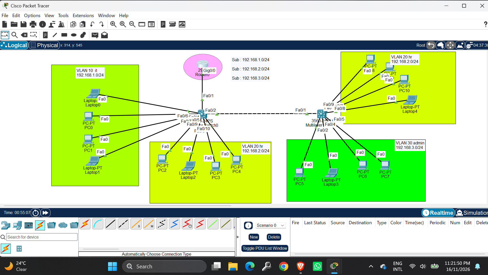
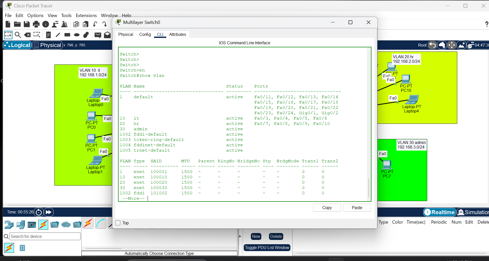
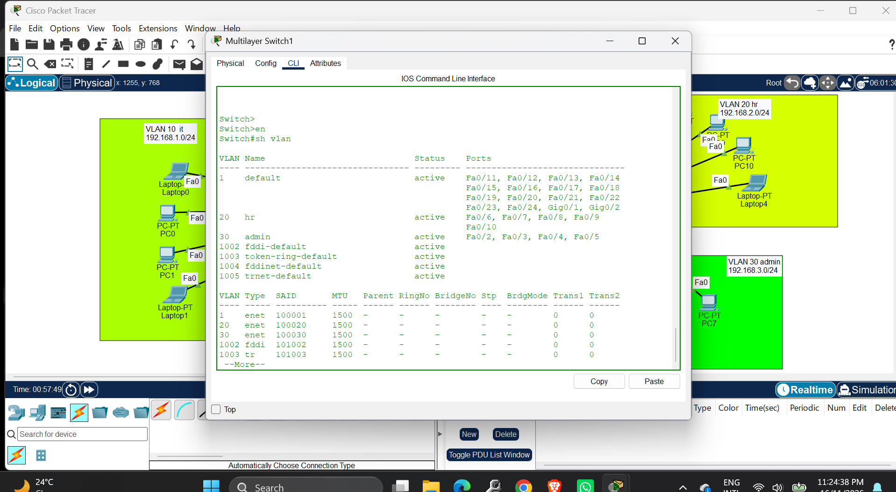
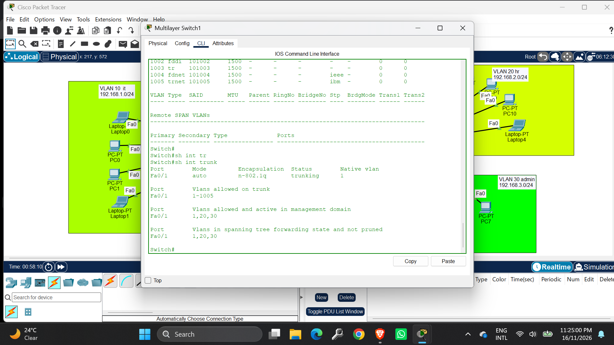
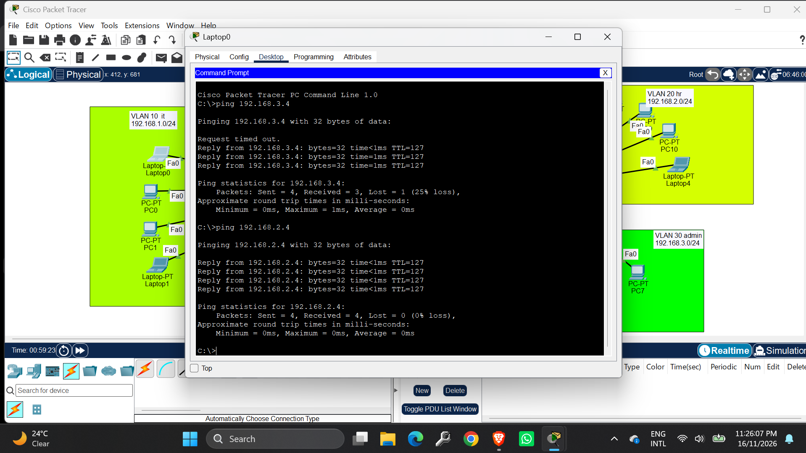

# 🌐 Enterprise Network Configuration: VLAN, Trunking & Inter-VLAN Routing with DHCP

This repository contains a **Cisco Packet Tracer** lab project demonstrating network segmentation using **VLANs**, inter-switch communication via **802.1Q Trunking**, and **Router-on-a-Stick** for Inter-VLAN Routing along with automated IP assignment using **DHCP**.

---

## 📌 Project Overview

The network is designed for a small-to-medium organization divided into three primary departments (**IT**, **HR**, and **Admin**). Two multilayer switches are used at the access/distribution layer to connect end devices across different physical areas, while a central Cisco 2911 Router handles inter-VLAN routing and acts as the central DHCP server.

### 🖼️ Network Topology

---

## 🗂️ VLAN & Subnetting Plan

| VLAN ID | Department Name | Network Address | Subnet Mask | Default Gateway | Assigned Switch Ports |
| :--- | :--- | :--- | :--- | :--- | :--- |
| **VLAN 10** | `it` (IT Dept) | `192.168.1.0/24` | `255.255.255.0` | `192.168.1.1` | Switch0: `Fa0/3 - Fa0/6` |
| **VLAN 20** | `hr` (HR Dept) | `192.168.2.0/24` | `255.255.255.0` | `192.168.2.1` | Switch0: `Fa0/7 - Fa0/10` Switch1: `Fa0/6 - Fa0/10` |
| **VLAN 30** | `admin` (Admin Dept) | `192.168.3.0/24` | `255.255.255.0` | `192.168.3.1` | Switch1: `Fa0/2 - Fa0/5` |

---

## ⚙️ Core Configurations Implemented

### 1. VLAN Creation & Port Assignment
* Created VLAN 10 (`it`), VLAN 20 (`hr`), and VLAN 30 (`admin`) across the switching infrastructure.
* Configured access ports (`switchport mode access`) and assigned them to their respective departmental VLANs.

#### Switch0 VLAN Verification (`show vlan`)

#### Switch1 VLAN Verification (`show vlan`)

---

### 2. IEEE 802.1Q Trunking
* Configured **Trunk Links** to carry traffic for multiple VLANs between switches and up to the router:
  * **Switch0 `Fa0/1`** $\leftrightarrow$ **Router0 `Gig0/0`** (Router-on-a-Stick uplink)
  * **Switch0 `Fa0/2`** $\leftrightarrow$ **Switch1 `Fa0/1`** (Inter-switch trunk link)

#### Switch0 Trunk Verification (`show interfaces trunk`)

#### Switch1 Trunk Verification (`show interfaces trunk`)

---

### 3. Inter-VLAN Routing & DHCP Server (Router0)
* Configured sub-interfaces on Router0 (`Gig0/0.10`, `Gig0/0.20`, `Gig0/0.30`) with `encapsulation dot1Q <vlan-id>`.
* Configured three separate **DHCP Pools** on Router0 so all PCs and Laptops dynamically receive IP addresses, subnet masks, and default gateways without manual static configuration.

---

## 🧪 Connectivity & Ping Verification

To verify end-to-end network functionality, an ICMP `ping` test was executed from **Laptop0** (located in **VLAN 10 - IT**, `192.168.1.0/24`) to hosts in other VLANs:
* **Ping to VLAN 30 (Admin):** `ping 192.168.3.4` $\rightarrow$ **Success** (Initial packet dropped due to ARP resolution, followed by 100% reply).
* **Ping to VLAN 20 (HR):** `ping 192.168.2.4` $\rightarrow$ **Success** (0% packet loss).

---

## 🚀 How to Run This Project

1. Download and install **Cisco Packet Tracer** (v8.0 or higher recommended).
2. Clone this repository or download the `.pkt` project file.
3. Open the file in Cisco Packet Tracer.
4. Click on any PC/Laptop $\rightarrow$ **Desktop** $\rightarrow$ **IP Configuration** to verify DHCP lease acquisition, or open **Command Prompt** to test cross-VLAN connectivity.